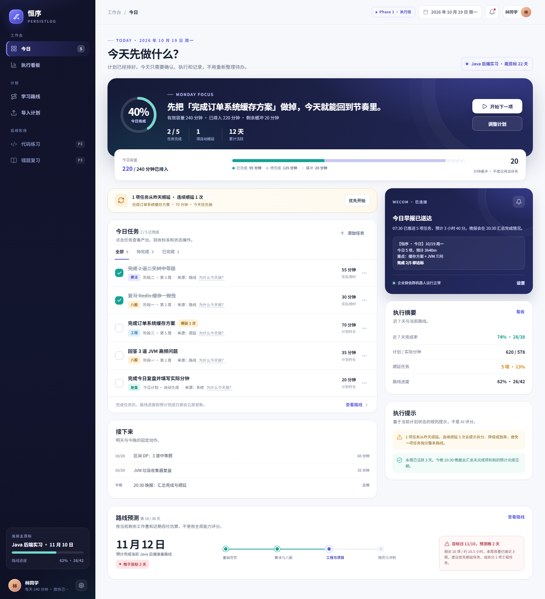
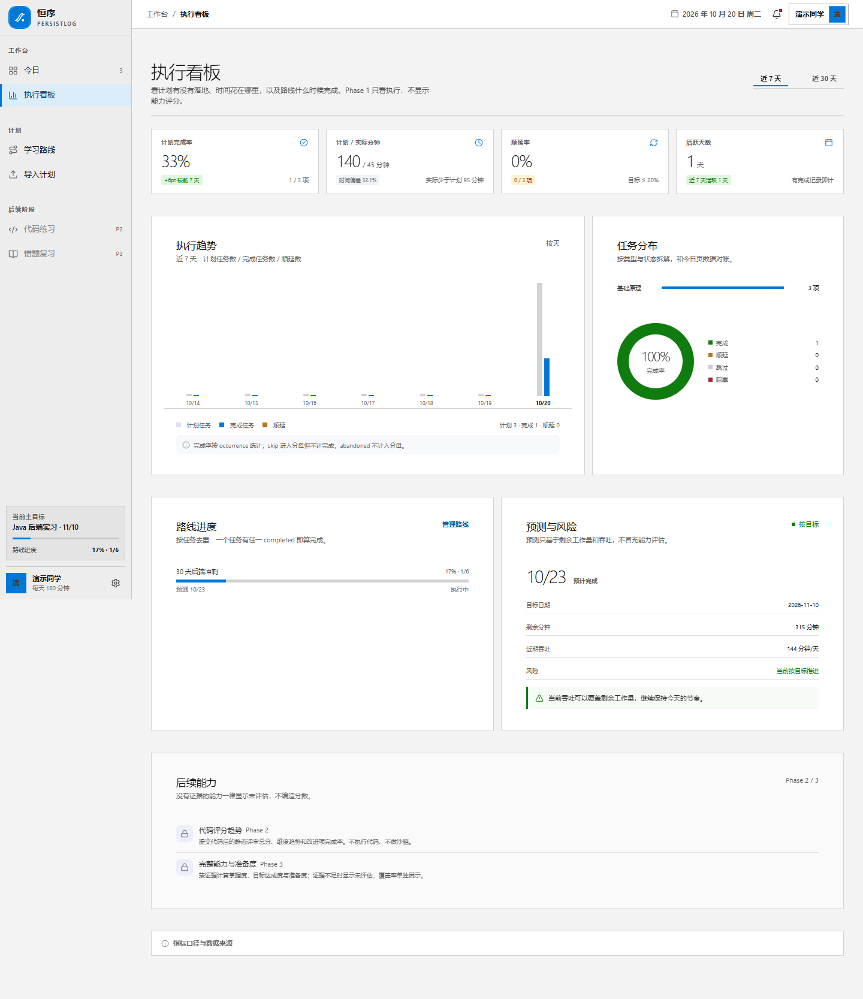
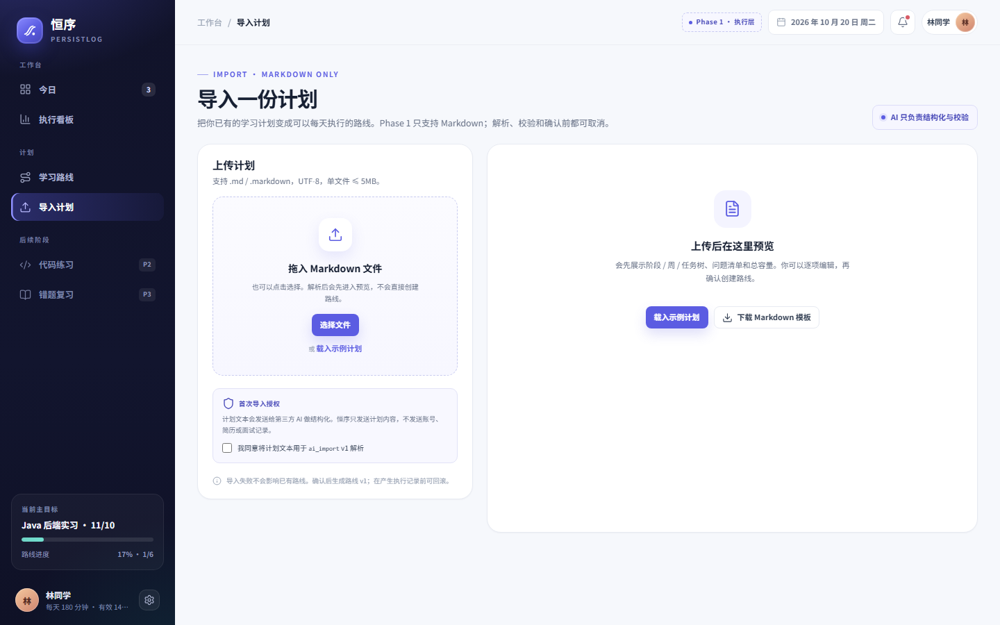
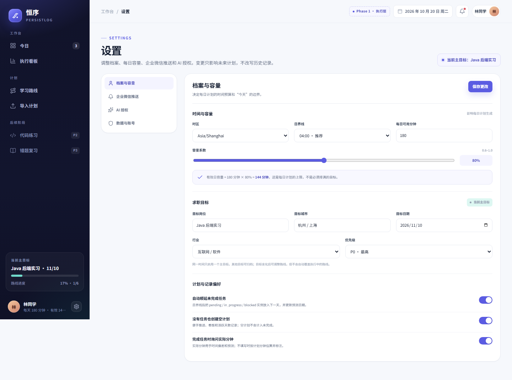

# 恒序 persistLog · Frontend

**当前状态**：Phase 1 页面已完成前后端联调与本轮视觉精修；以当前 React 页面和 `docs/frontend-design-guidelines.md` 为实现基准

**技术栈**：Next.js 16（App Router）+ React 19 + TypeScript；当前工程仍通过 `uwp_components` 承载旧版视觉适配

**数据状态**：由启动/构建命令选择全项目 Mock 或 Live。默认 Live；Mock 包含 P1 演示登录与数据，不依赖后端；Live 失败不会回退为示例。

**日期**：2026-11-19

**远程仓库**：<https://github.com/QingTong1-ops/PersistLog.git>

**分支**：`frontend-master`

> 恒序把「计划 / 困境」翻译成「今天做什么」，再把「今天做了什么」翻译成「有没有更接近目标」。
> Phase 1 只做计划落地、今日执行、学习路线、执行看板和企微推送；代码评审、错题复习、完整能力看板属于 Phase 2/3。

---

## 1. 快速开始

要求：Node.js ≥ 22，项目依赖已安装。使用 pnpm；也可使用 `npm run <脚本名>`，不要因此重新生成另一份依赖锁文件。

### 无后端预览（全项目 Mock）

```powershell
pnpm dev:mock
```

进入 `/login`，已预填虚拟账号 `demo@persistlog.test` / `PreviewOnly!`；点击登录后查看 P1 页面。演示登录不验证真实账号，注册仅重置演示账户，不创建真实用户。**请勿输入真实密码、Webhook、私人计划等信息。**

页面持续显示“Mock · 演示模式”，可通过“重置演示”清空本标签页模拟数据并返回登录。任务、档案等写操作只保存在当前标签页的独立 `sessionStorage`，刷新保留；关闭标签页后清除。不同标签页是独立演示副本，不模拟真实多账户权限。

### 后端联调（Live）

```powershell
# 终端 1：后端（仓库根目录）
cd D:\code\persistLog\persistLog
.\.venv\Scripts\python.exe -m uvicorn app.main:app --reload --port 8000

# 终端 2：前端
cd D:\code\persistLog\persistLogFrontend
pnpm install
Copy-Item .env.example .env.local
pnpm dev:live
```

打开 <http://localhost:3000>。仅 Live 使用 `next.config.ts` rewrite，把 `/api/v1/*` 转到 `BACKEND_API_URL`。Mock 禁用此代理，所有已支持的数据请求在浏览器本地处理，不发送 Cookie、计划或通知给后端。

本地联调种子账号（仅开发库）：`lin.frontend@example.com` / `persistlog123`。

> 开发环境请使用 `http://localhost:3000`，不要用 `127.0.0.1`，否则 Next.js 的开发资源可能被跨域策略拦截。
> 如确实需要 127.0.0.1，`next.config.ts` 已把 `127.0.0.1` 加入 `allowedDevOrigins`。
> 若改前端端口，后端 `CORS_ORIGINS` 必须加入完整 Origin；本地默认已包含 3000/3001。

### 常用脚本

| 命令 | 作用 |
| --- | --- |
| `pnpm dev:mock` | 全项目演示模式；P1 本地适配器，P2/P3 后续沿用同一选择 |
| `pnpm dev:live` / `pnpm dev` | 全项目真实接口模式 |
| `pnpm build:mock` | 构建演示版本到 `.next/mock` |
| `pnpm build:live` / `pnpm build` | 构建真实接口版本到 `.next/live` |
| `pnpm start:mock` | 启动已完成的 Mock 构建 |
| `pnpm start:live` / `pnpm start` | 启动已完成的 Live 构建 |
| `pnpm lint` | ESLint |
| `pnpm typecheck` | 检查工程源码，不依赖某次生成的 `.next` 类型 |
| `pnpm typecheck:mock` / `pnpm typecheck:live` | 检查源码及对应构建的路由类型 |
| `pnpm test:modes` | 启动参数、Mock P1 流程、Live 不回退及认证刷新测试 |
| `pnpm test:modes:smoke` | 两种 build 完成后验证 HTTP 路由壳、登录入口、构建标记及代理隔离 |
| `pnpm test:modes:dev` | 实际启动两种 dev 模式并检查登录页；测试仅结束自己创建的服务 |

命令使用**英文冒号**。跨平台 Node 启动器 `scripts/run-mode.mjs` 注入 `NEXT_PUBLIC_DATA_SOURCE=mock|live`，无需改 `.env.local`，不接受页面 URL 参数切换模式。命令选择优先于继承的环境变量；不要直接用 `next dev/start` 绕过入口。

开发模式切换需要先结束旧进程再启动。需要并行预览时用不同端口，例如 `pnpm dev:mock --port 3100` 与 `pnpm dev:live --port 3101`。浏览器入口 `/` 和 `/login` 均保持登录注册行为，不因切换数据源自动登录。

生产示例：`pnpm build:mock` → `pnpm start:mock`。**模式在构建时固定，不能用 start 将 Mock 产物变成 Live。** 两套产物、开发缓存、TypeScript 增量缓存分开；启动器验证模式和 BUILD_ID，未构建/标记不匹配会拒绝启动，而不是误用另一套产物。`next-env.d.ts` 是 Next 自动生成文件，可能随最后一次运行变化；类型检查使用稳定引用和分模式配置，不依赖它选择数据源。

### P1 Mock 覆盖与限制

| 模块 | 演示覆盖 |
| --- | --- |
| 登录/注册/会话 | 虚拟身份、刷新恢复、退出、重置；不写真实认证 Cookie，不保存密码 |
| 今日/路线 | 任务读取、新增、开始/完成/延期/跳过/阻塞/解除/放弃/拆分；路线读取、新建、状态切换、容量调整；进度同步 |
| 执行看板 | 基于演示任务生成 7/30 天概览、趋势、分布及演示预测 |
| 导入 | 本地固定示例预览、编辑、确认、取消、回滚；**不解析上传文件、不调用 AI** |
| 档案/目标/授权 | 当前已接入表单的本地保存和刷新读取 |
| 通知 | 渠道、偏好、Outbox、测试/重发的本地模拟；**不会真正发送企微消息，也不保存 Webhook 原文** |

未实现的 Mock 请求明确返回 `MOCK_NOT_IMPLEMENTED`，绝不转发真实后端。当前 P1 原有未开放功能、占位按钮不会因为模式配置变成真实能力；本轮也未新增 P2/P3 页面或接口。Mock 的调度/解析/预测只用于效果预览，不作为后端算法或真实联调验收证据。

实现与验证细节见 [数据源运行说明](docs/data-source-modes.md)。

---

## 2. 当前路由

| 路由 | 页面 | 状态 |
| --- | --- | --- |
| `/login` | 登录 / 注册 | 真实后端，Access Token 内存 + Refresh HttpOnly Cookie |
| `/onboarding` | 4 步首次引导 | 档案、目标、AI 授权真实保存；步骤 3 文件仍为占位 |
| `/today` | 今日任务、容量、顺延、路线预测 | 真实 `GET /today` + occurrence 动作，乐观刷新 |
| `/import` | Markdown 上传 / 解析 / 预览 / 确认 | 真实 multipart + Job 轮询 + 确认/回滚；预览内联编辑暂为本地 |
| `/routes` | 路线列表 | 真实 `GET /routes`，新建/暂停/恢复 |
| `/routes/[id]` | 路线详情、阶段/周/任务、版本、设置 | 真实详情 + 暂停/归档/调整日期/容量 |
| `/dashboard` | 执行看板 7/30 天 | 真实 overview/trends/distribution/forecast |
| `/settings/profile` | 档案与容量 | 真实 `PUT /profile` + 主目标更新 |
| `/settings/notifications` | 企业微信推送 | 渠道/偏好/Outbox 真实读取；创建/测试/删除已接 |
| `/settings/ai` | AI 授权 | 真实 `PUT /consents`（通过 store） |
| `/settings/data` | 数据与账号 | 退出登录、会话刷新真实 |

上表描述 Live 接入范围；Mock 使用相同页面与 DTO，经统一请求层换成本地适配器。旧 `?state=` 入口不再作为数据模式/业务状态切换方式；请在 Mock 中操作任务/导入来预览状态。

开发环境顶栏「页面地图」用于导航；生产构建默认隐藏，可通过 `NEXT_PUBLIC_SHOW_DEV_NAV=true` 打开。该选项不改变数据源。

---

## 3. 目录结构

```text
persistLogFrontend/
├─ app/
│  ├─ layout.tsx                 # 根布局、Provider
│  ├─ page.tsx                   # 跳转 /today
│  ├─ globals.css                # 业务布局与旧版基础类
│  ├─ uwp.css                    # 旧版 UWP 皮肤兼容层
│  ├─ optimized.css              # optimized 正式视觉覆盖层（迁移中）
│  ├─ error.tsx / not-found.tsx
│  ├─ (app)/
│  │  ├─ layout.tsx              # 侧边栏 + 顶栏 + 移动端导航
│  │  ├─ today/
│  │  ├─ import/
│  │  ├─ routes/ + routes/[id]/
│  │  ├─ dashboard/
│  │  └─ settings/ + settings/[tab]/
│  └─ (auth)/
│     ├─ login/
│     └─ onboarding/
├─ components/
│  ├─ uwp-root.tsx               # 旧版 ThemeRoot 适配（迁移中）
│  ├─ app-shell.tsx              # 桌面侧边栏、顶栏、移动端导航、页面地图
│  ├─ brand-mark.tsx
│  ├─ ui.tsx                     # 通用 Button/Pivot/ProgressBar/Modal 包装
│  ├─ today/                     # 今日视图、任务行、任务抽屉、状态弹窗
│  ├─ import/                    # 导入状态机
│  ├─ routes/                    # 路线列表、路线详情
│  ├─ dashboard/                 # KPI、趋势、分布、预测
│  ├─ settings/                  # 四个设置面板
│  └─ auth/                      # 登录、引导
├─ lib/
│  ├─ types.ts                   # Task/Route/Dashboard/Preview 类型
│  ├─ mock-data.ts               # 未登录时保留的设计演示数据
│  ├─ auth/auth-provider.tsx     # 登录、注册、刷新、登出、会话初始化
│  ├─ store/app-store.tsx        # today/routes/profile 真实数据 + 今日动作
│  ├─ api/client.ts              # fetch、Bearer、401 单飞刷新、错误包
│  ├─ api/live.ts                # auth/today/imports/routes/dashboard/notifications
│  ├─ api/mappers.ts             # API → Task/Route/Dashboard 映射
│  └─ utils.ts                   # 状态标签、任务统计、路线进度
├─ design/
│  ├─ README.md                  # 原型索引与草稿边界
│  └─ p2p3/                      # P2 / P3 页面原型、共享样式与交互说明
├─ docs/
│  ├─ architecture.md            # 技术架构与接入说明
│  ├─ frontend-design-guidelines.md # P1 页面设计协作规范
│  └─ screenshots/               # 工程实现与历史验收截图
└─ .env.example
```

---

## 4. 架构要点

### 4.1 渲染模型

- 页面本身是 Server Component，负责读取 `searchParams` / `params` 和元数据。
- 视图组件是 Client Component（`"use client"`），负责交互和服务端状态。
- `(app)/layout.tsx` 提供 `SessionGate` + `AppShell`；未登录跳 `/login`。
- `(auth)` 使用独立全屏布局；登录成功后进入 `/today`，注册后进入 `/onboarding`。
- 数据源仅由命令决定；现有登录与路由守卫在两种模式下都保留。

### 4.2 状态层

`lib/store/app-store.tsx` 提供：

- 登录后加载 `GET /today`、`GET /routes`、`GET /profile`、`GET /job-targets`，映射为页面使用的 `Task` / `RouteRecord` / `DemoUser`。
- 今日动作：开始、完成、延期、跳过、阻塞、解除、放弃、拆分；每个动作调用 occurrence API，成功后重新拉取 today + routes。
- 路线状态：暂停 / 恢复 / 归档 / 调整日期与容量。
- 通知连接状态、AI 授权状态。
- 派生指标：完成率、容量、路线进度。

Store 从空状态加载所选适配器；Live 网络错误保留错误或已读取数据，不注入示例数据。登出/切换身份清空用户状态，过期响应不得回写。`lib/mock-data.ts` 中剩余历史常量/模板不是 Live 回退来源。

### 4.3 API 层

- `lib/api/client.ts`：`apiFetch<T>`、`ApiError`、`X-Request-ID`、`credentials: include`、401 单飞刷新、失败重试一次。
- `lib/api/live.ts`：auth / today / imports / routes / dashboard / notifications 的真实端点与类型。
- `lib/api/mappers.ts`：TodayItem → Task、RouteDetail → 路线/阶段、Dashboard → 图表数据集。
- `lib/auth/auth-provider.tsx`：登录、注册、`/auth/me` 初始化、刷新、登出；SessionGate 负责路由守卫。
- 认证契约：Access Token 内存，Refresh Token HttpOnly Cookie；前端不写 localStorage。
- 部署：Next rewrite 把 `/api/v1/*` 转到 `BACKEND_API_URL`，浏览器同源，避免 Cookie `SameSite` 问题。
- 导入接入：`POST /imports` + `GET /jobs/{id}` 轮询 + `GET/PATCH /imports/{id}/preview` + 确认/回滚。
- 指标口径：看板数字与今日页、路线详情共用同一后端口径。

### 4.4 样式

当前页面以 `docs/frontend-design-guidelines.md` 和 React 实现为基准：

- `app/optimized.css` 已接入根布局，提供当前 Shell、Today、Dashboard、Routes、Import、Settings、Auth 的共享视觉 token 和响应式覆盖。
- `app/globals.css`、`app/uwp.css`、`uwp-root.tsx` 与 `uwp_components` 暂作为兼容层保留；新页面不再扩展 UWP 专属视觉规则。
- 新页面优先复用 optimized token 与现有业务组件，保持浅色工作区、216px 桌面侧栏、12px 卡片圆角和清晰的信息层级。
- 桌面主内容必须位于 `.app-shell` 第二列；窄屏按 `860 / 640 / 560 / 420px` 断点重排，具体规则见设计协作规范。
- 不恢复已清理的 P1 静态原型和重复预览图；需要回溯旧方案时查阅 Git 历史。P2 / P3 规划原型仅在 `design/p2p3/`，不代表真实功能已经实现。深色主题不作为当前已验收能力。

---

## 5. 模块提交记录

按模块拆分提交，便于回溯：

| 提交 | 内容 |
| --- | --- |
| `94b382e` | Next.js + TypeScript 工程、全局样式、根布局 |
| `d54cb39` | 设计系统、数据层、AppShell、页面骨架 |
| `b9bf225` | 登录 / 注册、4 步首次引导 |
| `4f4051b` | 今日执行、任务抽屉、完成/延期/跳过/阻塞/拆分 |
| `582fd29` | Markdown 导入状态机、预览、问题清单、确认/回滚 |
| `5649a7b` | 路线列表、路线详情、阶段/周/任务、版本、调整 |
| `7103605` | 执行看板、7/30 天趋势、分布、预测 |
| `ab210aa` | 档案、企微推送、AI 授权、数据与账号 |
| `docs`（上一轮） | API 客户端、环境变量、架构文档、README、截图 |
| **本次联调** | Next rewrite、AuthProvider/SessionGate、真实 today/import/routes/dashboard/settings、API mappers、联调文档与截图 |
| **Phase 1 收尾** | 空计划回填、`/today/items` 手动加任务、预览 PATCH、阶段/周进度、验收文档与截图 |
| **旧版 UWP 视觉重构** | `uwp_components`、ThemeRoot、`app/uwp.css`；作为迁移前实现保留 |

原型与设计文档的历史仍保留在前面的 `ed45972` 提交。

---

## 6. 验证

最近一次验证（本地后端 8000 + 前端 3000）：

```bash
pnpm lint        # 通过
pnpm typecheck   # 通过
pnpm build       # 通过
```

真实链路覆盖：

- 登录后 `/today` 返回 3 项 / 140 分钟 / 有效容量 144；刷新页面仍保持登录。
- 完成「TCP 三次握手」后：今日 0% → 33%（1/3），路线 0% → 17%（1/6），后端 `/today` 与 `/dashboard/overview` 同步。
- 导入真实 Markdown：上传 → Job 轮询 → 预览（2 阶段 / 2 周 / 3 任务 / 180 分钟）→ 编辑任务 → `PATCH preview` → 前端显示编辑后的标题。
- 今日手动添加「Phase1 回归任务」后 4 项；刷新页面仍为 4 项，证明 `POST /today/items` 已持久化。
- 空计划回填：新用户先 `GET /today` 生成 0 项计划，再导入路线；同一 `plan_id` 下一次 `GET /today` 自动补齐 3 项 / 140 分钟。
- 路线详情阶段/周进度直接来自后端：阶段 `1/4 · 25%`、周 `完成 1/3`。
- 看板 7/30 天、分布、预测、路线进度均来自真实接口。
- 设置档案显示 180 分钟 / 80% / 有效 144；未配置企微时显示「未配置」，测试按钮禁用。
- 后端 `pytest` 全绿。
- 桌面 1440px 与移动端 390px 布局通过。

截图（以下为 Phase 1 联调时的旧版 UWP 验收记录，不代表当前页面视觉）：

| 今日 | 执行看板 |
| --- | --- |
|  |  |

| 导入上传 | 设置 |
| --- | --- |
|  |  |

更多：[登录](docs/screenshots/login.png)、[移动端今日](docs/screenshots/today-mobile.png)。

联调演示账户（`demo@persistlog.dev`）：

今日与看板演示截图和正式截图内容重复，已删除重复文件。

[演示路线详情](docs/screenshots/demo-route.png)

---

## 7. 已知限制

1. 引导步骤 3 的文件选择仍是占位，导入在 `/import` 完成。
2. 企微测试发送需要有效 Webhook；`send_time` 已存储但定时调度仍按后端默认时间。
3. 没有自动化 E2E；当前为 lint/typecheck/build + 浏览器手工验收。
4. 时间戳仍按 UTC 解析（后端当前不带 `Z`）。
5. Phase 2/3 的 React 页面与真实接口尚未开始；规划原型和接入说明见 `design/p2p3/README.md`，不视为已验收功能。

---

## 8. 下一步

1. 增加 TanStack Query 缓存与请求去重，减少 today/routes/dashboard 的重复拉取。
2. 补 Playwright：登录 → 导入 → 今日完成 → 看板 → 设置；CI 跑 lint/typecheck/build/E2E。
3. 接真实企微 Webhook 验证测试发送、失败重试、Outbox。
4. 补生产部署配置：同源反向代理、HTTPS Cookie、CORS 白名单与监控。
5. 完成 7 天真实使用与 20 条任务数据后进入 Phase 2。

---

## 9. 分支与推送

```bash
git remote -v
# origin  https://github.com/QingTong1-ops/PersistLog.git (fetch)
# origin  https://github.com/QingTong1-ops/PersistLog.git (push)

git branch -vv
# * frontend-master ... origin/frontend-master
```

前端在 `frontend-master`，后端代码在 `backend-main`，两个分支历史独立；合并策略在前端工程化稳定后再确定。

---

## 10. 文档索引

| 文档 | 内容 |
| --- | --- |
| [docs/architecture.md](docs/architecture.md) | 技术架构、数据流、API 接入方式 |
| [docs/data-source-modes.md](docs/data-source-modes.md) | 全项目启动/构建模式、P1 Mock 覆盖和验证记录 |
| [docs/p2-engineering-plan.md](docs/p2-engineering-plan.md) | P2 任务计划与 Mock/Live 接入步骤 |
| [docs/p3-engineering-plan.md](docs/p3-engineering-plan.md) | P3 任务计划与 Mock/Live 接入步骤 |
| [docs/phase1-acceptance.md](docs/phase1-acceptance.md) | Phase 1 验收、回填/预览/加任务证据与上线检查 |
| [docs/frontend-design-guidelines.md](docs/frontend-design-guidelines.md) | **当前 P1 页面设计协作基准**：视觉、布局、动效、细节与文字内容 |
| [design/p2p3/README.md](design/p2p3/README.md) | **P2 / P3 规划原型**：页面、主流程、异常状态、数据口径与工程边界 |
| [docs/01-产品与功能.md](https://github.com/QingTong1-ops/PersistLog/blob/backend-main/docs/01-产品与功能.md) | 产品范围、功能规格、验收 |
| [docs/02-技术设计.md](https://github.com/QingTong1-ops/PersistLog/blob/backend-main/docs/02-技术设计.md) | 架构、数据、API、算法 |
| [docs/openapi.json](https://github.com/QingTong1-ops/PersistLog/blob/backend-main/docs/openapi.json) | 当前后端契约 |

---

**维护者**：恒序 persistLog  
**最后更新**：2026-11-19
