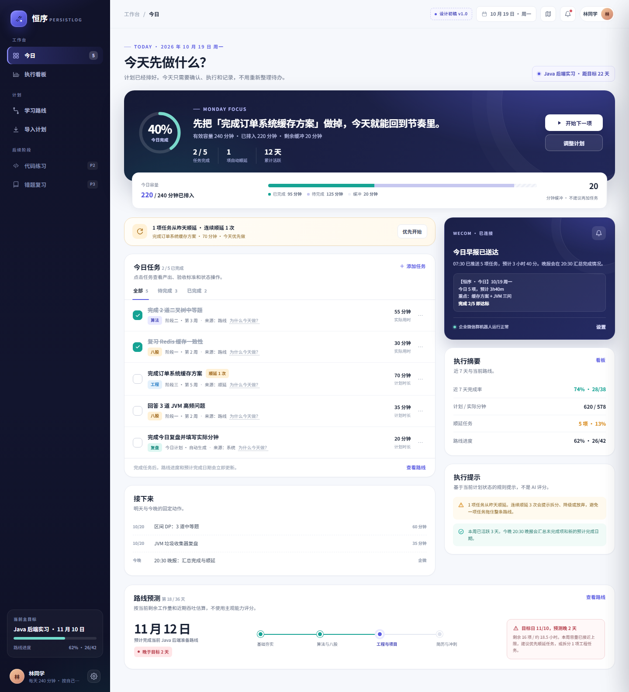
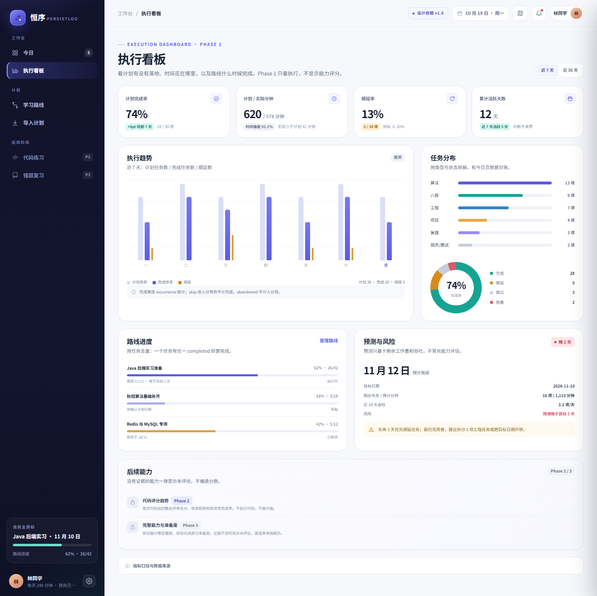
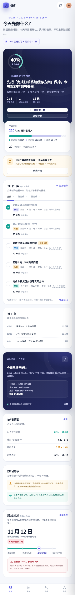
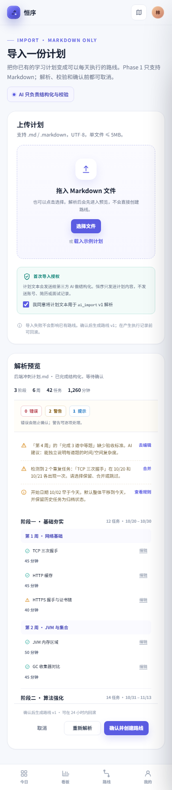

# 恒序 persistLog · Frontend

**当前内容**：Phase 1 前端设计初稿（静态可交互原型 + 视觉规范 + 页面规格）  
**状态**：设计初稿，可评审；尚未接入后端 API，尚未搭建 React/Next.js 工程  
**日期**：2026-10-19  
**远程仓库**：<https://github.com/QingTong1-ops/PersistLog.git>  
**目标分支**：`frontend-master`

> 恒序把「计划 / 困境」翻译成「今天做什么」，再把「今天做了什么」翻译成「有没有更接近目标」。Phase 1 只做计划落地、今日执行、路线、执行看板和企微推送；代码评审、错题复习、完整能力看板属于后续阶段。

---

## 1. 快速预览

原型是纯 HTML / CSS / JS，没有构建步骤，也没有外部依赖。

### 方式 A：直接打开

双击或在浏览器打开：

```text
design/persistlog-phase1-prototype.html
```

使用哈希路由，可直接分享深链：

```text
#/today
#/dashboard
#/routes/1
#/import?state=preview
#/settings/notifications
```

### 方式 B：本地静态服务器

在 `persistLogFrontend/` 下执行：

```bash
python -m http.server 5173
```

然后打开：

```text
http://127.0.0.1:5173/design/persistlog-phase1-prototype.html
```

> 如果 5173 被占用，换一个端口即可。原型不依赖 `/api`，所以不需要后端也能浏览。

### 演示入口

顶栏「设计初稿 v1.0 → 原型导航」可以打开所有页面和状态演示：

- 登录 / 注册、4 步首次引导。
- 今日、执行看板、学习路线、路线详情、导入上传/预览。
- 档案与容量、企业微信推送、AI 授权、数据与账号。
- 今日全部完成、今日无任务、导入失败、路线空态、看板空态。
- 「重置演示数据」恢复初始状态。

### 预览图

| 桌面端 · 今日 | 桌面端 · 执行看板 |
| --- | --- |
|  |  |

| 移动端 · 今日 | 移动端 · 导入预览 |
| --- | --- |
|  |  |

更多预览：[路线详情](design/previews/desktop-route-detail.png)、[导入预览](design/previews/desktop-import.png)、[移动端看板](design/previews/mobile-dashboard.png)。

---

## 2. 目录结构

```text
persistLogFrontend/
├─ README.md
├─ .gitignore
└─ design/
   ├─ persistlog-phase1-prototype.html   # 页面结构与演示内容
   ├─ prototype.css                     # 设计 token、组件、响应式
   ├─ prototype.js                      # 哈希路由、任务状态、导入/看板交互
   ├─ visual-design.md                  # 视觉与页面设计说明 v2.0
   ├─ page-spec.md                      # 逐页规格、API 映射、验收点
   └─ previews/                         # 评审用截图（可选）
```

---

## 3. 本版设计范围

### 3.1 已覆盖（Phase 1）

| 模块 | 页面 |
| --- | --- |
| 账户 | `/login` 登录/注册 |
| 引导 | `/onboarding` 档案 → 目标 → 导入 → 通知 |
| 执行 | `/today` 今日任务、容量、顺延、完成/延期/跳过/阻塞/放弃/拆分 |
| 计划 | `/import` 上传、解析、预览、问题清单、确认、回滚 |
| 路线 | `/routes`、`/routes/{id}` 列表、阶段/周/任务、版本、调整 |
| 看板 | `/dashboard` 完成率、趋势、分布、路线进度、预测 |
| 设置 | `/settings/profile`、`/settings/notifications`、`/settings/ai`、`/settings/data` |

### 3.2 明确不做（Phase 1）

- AI 教练建议、能力差距、已具备能力、准备度分数。
- 代码提交、静态评审、评分趋势（Phase 2）。
- 错题复习、每日提问、AI 诊断/路线生成、完整能力看板（Phase 3）。
- 沙箱判题、CLI/IDE、平台数据交换、社区、投递、管理后台。

侧边栏和看板用 P2/P3 锁定项说明后续能力，不显示假分数。

---

## 4. 关键设计决策

1. **执行优先**：今日页第一屏只回答“今天做什么、还剩多少容量、路线会不会晚”。
2. **容量约束**：每日有效容量 = 每日可用 × 容量系数，默认 80%；今日 240 分钟、已排 220、缓冲 20。
3. **不制造打卡焦虑**：展示累计活跃天数，不做连续打卡；完成态不追加压力文案。
4. **状态可恢复**：延期、跳过、阻塞、放弃都有明确语义；放弃不计完成率分母。
5. **无证据不评分**：Phase 1 看板只做执行；Phase 2/3 能力区锁定并说明口径。
6. **移动端四入口**：今日 / 看板 / 路线 / 我的；导入从今日/路线入口进入。
7. **数据对账**：演示数据统一为 42 任务 / 26 完成 / 62% / 预测 11-12 / 目标 11-10；今日 5 项 / 220 分钟 / 2 完成。
8. **可访问性**：焦点环、键盘操作、状态文字 + 颜色、进度环文本百分比、`prefers-reduced-motion`。

详细规范见：

- [视觉与页面设计](design/visual-design.md)
- [页面规格与 API 映射](design/page-spec.md)

---

## 5. 原型交互说明

原型中的操作只修改浏览器内存状态，刷新即恢复初始演示数据。

| 操作 | 结果 |
| --- | --- |
| 点击任务 / 「开始下一项」 | 打开右侧任务详情抽屉 |
| 完成任务 | 填写实际分钟和备注；进度环、容量、路线进度、侧边栏同步更新 |
| 延期 | 标记「已移明天」，顺延数 +1，提示预测日期变化 |
| 跳过 | 必填原因；任务保留在列表但不再自动进入今日 |
| 阻塞 / 解除 | 阻塞保持到明天；解除后恢复待开始 |
| 放弃 | 二次确认；任务归档，不计完成率分母 |
| 拆分 | 原任务归档，生成两个子任务 |
| 导入示例 | 需先勾选 `ai_import` 授权；约 3 秒后进入预览 |
| 确认导入 | 显示成功态，可回滚 |
| 撤销 AI 授权 | 二次确认；状态变为未授权，可重新授权 |

---

## 6. 从原型到实现

技术基线来自 `docs/02-技术设计.md`：

- React + TypeScript + Next.js。
- 认证：Access Token 内存 + Refresh Token HttpOnly Cookie；不使用 localStorage 存 refresh token。
- 导入：`POST /imports` + `GET /jobs/{id}` 轮询；Broker 不可用时请求内降级。
- 页面数据：今日、路线、看板、通知均按 OpenAPI 契约接入。
- 组件迁移：`prototype.css` 的 token 和组件类可直接映射到 CSS Modules / Tailwind theme；布局与状态保持。

建议实现顺序：

1. 设计 token + 全局布局 + 登录/引导。
2. 今日页 + occurrence 状态动作。
3. 导入 + Job 轮询 + 预览编辑。
4. 路线列表/详情/版本/调整。
5. 看板 + 指标口径 + 空态。
6. 设置 + 通知 + 授权。
7. 响应式与可访问性回归。

---

## 7. Git 与分支

本目录是独立的 frontend 仓库，远程与后端共用同一个 GitHub 仓库，但分支独立：

```bash
git remote -v
# origin  https://github.com/QingTong1-ops/PersistLog.git (fetch)
# origin  https://github.com/QingTong1-ops/PersistLog.git (push)

git branch
# * frontend-master
```

推送：

```bash
git add .
git commit -m "feat(frontend): add phase 1 design draft prototype"
git push -u origin frontend-master
```

如本机需要通过本地代理访问 GitHub，可在命令前加：

```bash
git -c http.proxy=http://127.0.0.1:7897 -c http.sslBackend=openssl push -u origin frontend-master
```

> 后端代码在 `backend-main` 分支，前端设计初稿在 `frontend-master`，两者历史独立。合并策略在进入前端工程化时再确定。

---

## 8. 评审清单

- [ ] 今日页是否做到“打开就知道今天做什么”？
- [ ] 容量、完成率、路线进度、预测日期是否可对账？
- [ ] 完成/延期/跳过/阻塞/放弃/拆分是否有明确反馈？
- [ ] 导入的授权、解析、问题清单、确认、回滚是否完整？
- [ ] 路线详情的阶段/周/任务层级是否清楚？
- [ ] 看板是否只展示执行，不出现假能力分？
- [ ] 移动端底部导航、单列卡片、任务操作是否可用？
- [ ] Phase 2/3 的锁定说明是否足够清楚？

---

## 9. 已知限制

1. 原型数据写死在 `prototype.js`，刷新恢复；没有持久化。
2. 没有真实 API、认证 Cookie、CSRF/CORS、Job 轮询。
3. 导入解析是定时模拟，不是真实 Markdown 解析或 AI。
4. 企微测试发送、Outbox 重试、审计日志只做界面演示。
5. 路线详情任务表只展示 19/42 项关键任务，其余按结构折叠。
6. 正式版需要补表单校验、错误边界、埋点、真实空/加载/错误态和权限处理。

---

## 10. 文档索引

| 文档 | 内容 |
| --- | --- |
| [design/visual-design.md](design/visual-design.md) | 设计方向、token、组件、信息架构、页面内容、响应式 |
| [design/page-spec.md](design/page-spec.md) | 逐页规格、状态机、API 映射、验收点 |
| [design/persistlog-phase1-prototype.html](design/persistlog-phase1-prototype.html) | 可交互原型 |
| [docs/01-产品与功能.md](https://github.com/QingTong1-ops/PersistLog/blob/backend-main/docs/01-产品与功能.md) | 产品范围、功能规格、验收 |
| [docs/02-技术设计.md](https://github.com/QingTong1-ops/PersistLog/blob/backend-main/docs/02-技术设计.md) | 架构、数据、API、算法 |
| [docs/openapi.json](https://github.com/QingTong1-ops/PersistLog/blob/backend-main/docs/openapi.json) | 当前后端契约 |

---

**维护者**：恒序 persistLog  
**最后更新**：2026-10-19
