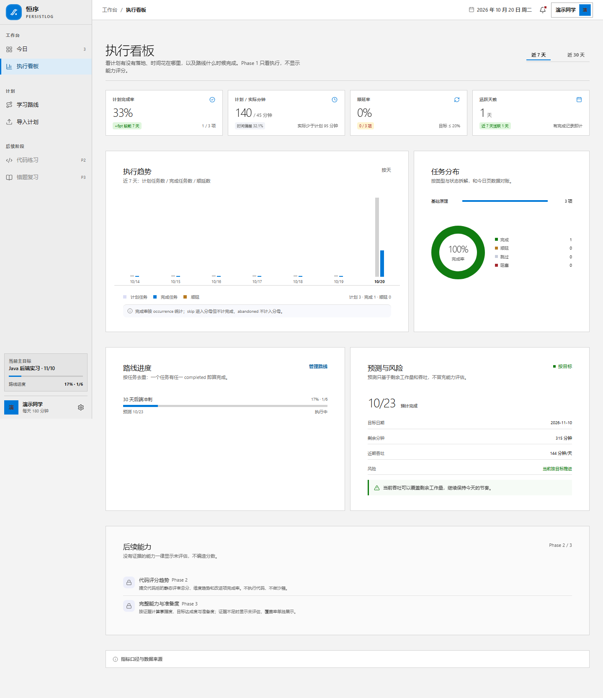
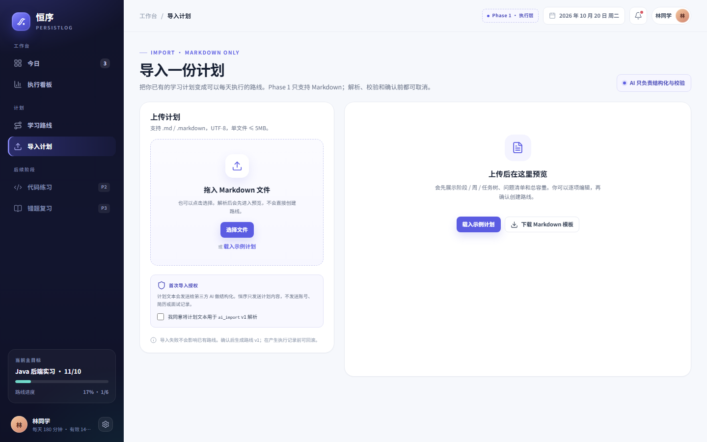
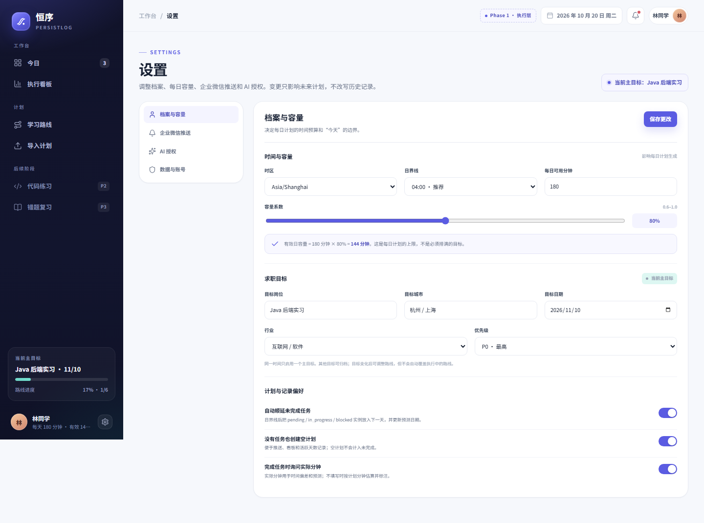
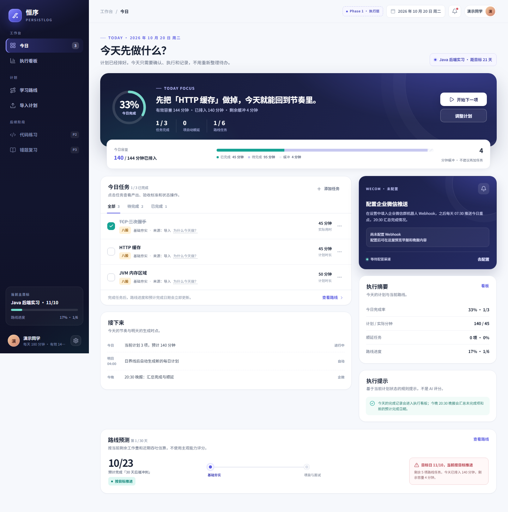
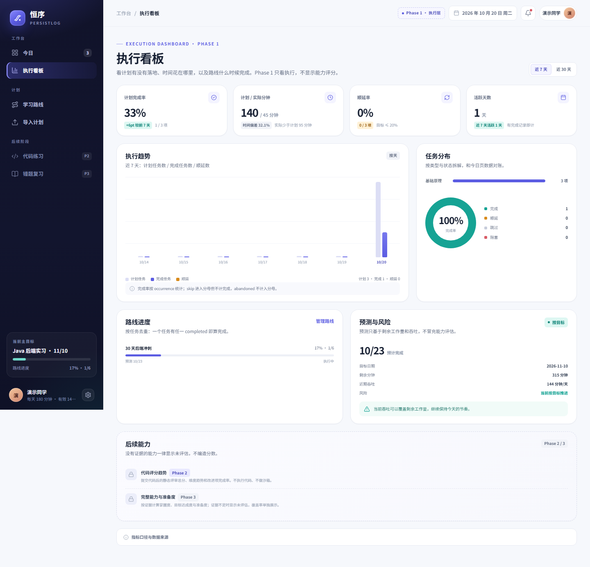

# 恒序 persistLog · Frontend

**当前状态**：Phase 1 页面已完成，并完成前后端联调（登录、今日、导入、路线、看板、档案、通知读取）  
**技术栈**：Next.js 16（App Router）+ React 19 + TypeScript + 原生 CSS  
**数据状态**：默认通过 Next.js rewrite `/api/v1/*` 调用本地 FastAPI；未登录时保留 mock 设计数据用于原型预览  
**日期**：2026-10-20  
**远程仓库**：<https://github.com/QingTong1-ops/PersistLog.git>  
**分支**：`frontend-master`

> 恒序把「计划 / 困境」翻译成「今天做什么」，再把「今天做了什么」翻译成「有没有更接近目标」。
> Phase 1 只做计划落地、今日执行、学习路线、执行看板和企微推送；代码评审、错题复习、完整能力看板属于 Phase 2/3。

---

## 1. 快速开始

要求：Node.js ≥ 22，pnpm ≥ 12；本地后端 FastAPI 已启动。

```powershell
# 终端 1：后端（仓库根目录）
cd D:\code\persistLog\persistLog
.\.venv\Scripts\python.exe -m uvicorn app.main:app --reload --port 8000

# 终端 2：前端
cd D:\code\persistLog\persistLogFrontend
pnpm install
Copy-Item .env.example .env.local
pnpm dev
```

打开 <http://localhost:3000>。前端通过 `next.config.ts` 的 rewrite 把 `/api/v1/*` 转到 `BACKEND_API_URL`，浏览器只看到同源地址，Refresh Cookie 不跨 host。

本地联调种子账号（仅开发库）：`lin.frontend@example.com` / `persistlog123`。

> 开发环境请使用 `http://localhost:3000`，不要用 `127.0.0.1`，否则 Next.js 的开发资源可能被跨域策略拦截。
> 如确实需要 127.0.0.1，`next.config.ts` 已把 `127.0.0.1` 加入 `allowedDevOrigins`。
> 若改前端端口，后端 `CORS_ORIGINS` 必须加入完整 Origin；本地默认已包含 3000/3001。

### 常用脚本

| 命令 | 作用 |
| --- | --- |
| `pnpm dev` | 启动开发服务器（Turbopack） |
| `pnpm build` | 生产构建 + TypeScript 检查 |
| `pnpm start` | 启动生产构建 |
| `pnpm lint` | ESLint |
| `pnpm typecheck` | `tsc --noEmit` |

---

## 2. 当前路由

| 路由 | 页面 | 状态 |
| --- | --- | --- |
| `/login` | 登录 / 注册 | 真实后端，Access Token 内存 + Refresh HttpOnly Cookie |
| `/onboarding` | 4 步首次引导 | 档案、目标、AI 授权真实保存；步骤 3 文件仍为占位 |
| `/today` | 今日任务、容量、顺延、路线预测 | 真实 `GET /today` + occurrence 动作，乐观刷新 |
| `/import` | Markdown 上传 / 解析 / 预览 / 确认 | 真实 multipart + Job 轮询 + 确认/回滚；预览内联编辑暂为本地 |
| `/routes` | 路线列表 | 真实 `GET /routes`，新建/暂停/恢复 |
| `/routes/[id]` | 路线详情、阶段/周/任务、版本、设置 | 真实详情 + 暂停/归档/调整日期/容量 |
| `/dashboard` | 执行看板 7/30 天 | 真实 overview/trends/distribution/forecast |
| `/settings/profile` | 档案与容量 | 真实 `PUT /profile` + 主目标更新 |
| `/settings/notifications` | 企业微信推送 | 渠道/偏好/Outbox 真实读取；创建/测试/删除已接 |
| `/settings/ai` | AI 授权 | 真实 `PUT /consents`（通过 store） |
| `/settings/data` | 数据与账号 | 退出登录、会话刷新真实 |

> `?state=...` 设计演示只在未登录的 mock 模式生效；登录后不会被演示状态覆盖真实数据。

状态演示：

- `/today?state=done`：今日全部完成
- `/today?state=empty`：今日无任务
- `/import?state=preview`：导入预览
- `/import?state=error`：导入解析失败
- `/routes?state=empty`：无路线
- `/dashboard?state=empty`：无执行记录

开发环境顶栏「页面地图」可打开所有路由和状态演示；生产构建默认隐藏，可通过 `NEXT_PUBLIC_SHOW_DEV_NAV=true` 打开。

---

## 3. 目录结构

```text
persistLogFrontend/
├─ app/
│  ├─ layout.tsx                 # 根布局、Provider、全局样式
│  ├─ page.tsx                   # 跳转 /today
│  ├─ globals.css                # 设计 token + 组件样式 + 响应式
│  ├─ error.tsx / not-found.tsx
│  ├─ (app)/
│  │  ├─ layout.tsx              # 侧边栏 + 顶栏 + 移动端导航
│  │  ├─ today/
│  │  ├─ import/
│  │  ├─ routes/ + routes/[id]/
│  │  ├─ dashboard/
│  │  └─ settings/ + settings/[tab]/
│  └─ (auth)/
│     ├─ login/
│     └─ onboarding/
├─ components/
│  ├─ app-shell.tsx              # 桌面侧边栏、顶栏、移动端导航、页面地图
│  ├─ brand-mark.tsx
│  ├─ ui.tsx                     # Button/Modal/Sheet/Toggle/Toast/进度等
│  ├─ today/                     # 今日视图、任务行、任务抽屉、状态弹窗
│  ├─ import/                    # 导入状态机
│  ├─ routes/                    # 路线列表、路线详情
│  ├─ dashboard/                 # KPI、趋势、分布、预测
│  ├─ settings/                  # 四个设置面板
│  └─ auth/                      # 登录、引导
├─ lib/
│  ├─ types.ts                   # Task/Route/Dashboard/Preview 类型
│  ├─ mock-data.ts               # 未登录时保留的设计演示数据
│  ├─ auth/auth-provider.tsx     # 登录、注册、刷新、登出、会话初始化
│  ├─ store/app-store.tsx        # today/routes/profile 真实数据 + 今日动作
│  ├─ api/client.ts              # fetch、Bearer、401 单飞刷新、错误包
│  ├─ api/live.ts                # auth/today/imports/routes/dashboard/notifications
│  ├─ api/mappers.ts             # API → Task/Route/Dashboard 映射
│  └─ utils.ts                   # 状态标签、任务统计、路线进度
├─ docs/
│  ├─ architecture.md            # 技术架构与接入说明
│  └─ screenshots/               # 实现截图
├─ design/                       # 原型、视觉规范、页面规格、设计预览
└─ .env.example
```

---

## 4. 架构要点

### 4.1 渲染模型

- 页面本身是 Server Component，负责读取 `searchParams` / `params` 和元数据。
- 视图组件是 Client Component（`"use client"`），负责交互和服务端状态。
- `(app)/layout.tsx` 提供 `SessionGate` + `AppShell`；未登录跳 `/login`。
- `(auth)` 使用独立全屏布局；登录成功后进入 `/today`，注册后进入 `/onboarding`。
- 设计演示 `?state=` 只在 mock 模式生效，不会 mutate 真实后端数据。

### 4.2 状态层

`lib/store/app-store.tsx` 提供：

- 登录后加载 `GET /today`、`GET /routes`、`GET /profile`、`GET /job-targets`，映射为页面使用的 `Task` / `RouteRecord` / `DemoUser`。
- 今日动作：开始、完成、延期、跳过、阻塞、解除、放弃、拆分；每个动作调用 occurrence API，成功后重新拉取 today + routes。
- 路线状态：暂停 / 恢复 / 归档 / 调整日期与容量。
- 通知连接状态、AI 授权状态。
- 派生指标：完成率、容量、路线进度。

未登录或未连后端时保留 `lib/mock-data.ts` 的演示数据，用于设计验收；登录后以真实数据为准。

### 4.3 API 层

- `lib/api/client.ts`：`apiFetch<T>`、`ApiError`、`X-Request-ID`、`credentials: include`、401 单飞刷新、失败重试一次。
- `lib/api/live.ts`：auth / today / imports / routes / dashboard / notifications 的真实端点与类型。
- `lib/api/mappers.ts`：TodayItem → Task、RouteDetail → 路线/阶段、Dashboard → 图表数据集。
- `lib/auth/auth-provider.tsx`：登录、注册、`/auth/me` 初始化、刷新、登出；SessionGate 负责路由守卫。
- 认证契约：Access Token 内存，Refresh Token HttpOnly Cookie；前端不写 localStorage。
- 部署：Next rewrite 把 `/api/v1/*` 转到 `BACKEND_API_URL`，浏览器同源，避免 Cookie `SameSite` 问题。
- 导入接入：`POST /imports` + `GET /jobs/{id}` 轮询 + `GET/PATCH /imports/{id}/preview` + 确认/回滚。
- 指标口径：看板数字与今日页、路线详情共用同一后端口径。

### 4.4 样式

`app/globals.css` 从设计原型迁移：

- `--brand-*` / `--ink-*` / 状态色 token。
- 卡片、按钮、标签、任务行、进度环、抽屉、弹窗、看板图表。
- 桌面侧边栏 + 移动端底部导航。
- `prefers-reduced-motion`、焦点环、状态文字 + 颜色。

详细规范见 [design/visual-design.md](design/visual-design.md) 与 [design/page-spec.md](design/page-spec.md)。

---

## 5. 模块提交记录

按模块拆分提交，便于回溯：

| 提交 | 内容 |
| --- | --- |
| `94b382e` | Next.js + TypeScript 工程、全局样式、根布局 |
| `d54cb39` | 设计系统、数据层、AppShell、页面骨架 |
| `b9bf225` | 登录 / 注册、4 步首次引导 |
| `4f4051b` | 今日执行、任务抽屉、完成/延期/跳过/阻塞/拆分 |
| `582fd29` | Markdown 导入状态机、预览、问题清单、确认/回滚 |
| `5649a7b` | 路线列表、路线详情、阶段/周/任务、版本、调整 |
| `7103605` | 执行看板、7/30 天趋势、分布、预测 |
| `ab210aa` | 档案、企微推送、AI 授权、数据与账号 |
| `docs`（上一轮） | API 客户端、环境变量、架构文档、README、截图 |
| **本次联调** | Next rewrite、AuthProvider/SessionGate、真实 today/import/routes/dashboard/settings、API mappers、联调文档与截图 |
| **Phase 1 收尾** | 空计划回填、`/today/items` 手动加任务、预览 PATCH、阶段/周进度、验收文档与截图 |

原型与设计文档的历史仍保留在前面的 `ed45972` 提交。

---

## 6. 验证

最近一次验证（本地后端 8000 + 前端 3000）：

```bash
pnpm lint        # 通过
pnpm typecheck   # 通过
pnpm build       # 通过
```

真实链路覆盖：

- 登录后 `/today` 返回 3 项 / 140 分钟 / 有效容量 144；刷新页面仍保持登录。
- 完成「TCP 三次握手」后：今日 0% → 33%（1/3），路线 0% → 17%（1/6），后端 `/today` 与 `/dashboard/overview` 同步。
- 导入真实 Markdown：上传 → Job 轮询 → 预览（2 阶段 / 2 周 / 3 任务 / 180 分钟）→ 编辑任务 → `PATCH preview` → 前端显示编辑后的标题。
- 今日手动添加「Phase1 回归任务」后 4 项；刷新页面仍为 4 项，证明 `POST /today/items` 已持久化。
- 空计划回填：新用户先 `GET /today` 生成 0 项计划，再导入路线；同一 `plan_id` 下一次 `GET /today` 自动补齐 3 项 / 140 分钟。
- 路线详情阶段/周进度直接来自后端：阶段 `1/4 · 25%`、周 `完成 1/3`。
- 看板 7/30 天、分布、预测、路线进度均来自真实接口。
- 设置档案显示 180 分钟 / 80% / 有效 144；未配置企微时显示「未配置」，测试按钮禁用。
- 后端 `pytest` 全绿。
- 桌面 1440px 与移动端 390px 布局通过。

截图：

| 今日 | 执行看板 |
| --- | --- |
|  |  |

| 导入上传 | 设置 |
| --- | --- |
|  |  |

更多：[登录](docs/screenshots/login.png)、[移动端今日](docs/screenshots/today-mobile.png)。

联调演示账户（`demo@persistlog.dev`）：

| 今日 | 看板 |
| --- | --- |
|  |  |

[演示路线详情](docs/screenshots/demo-route.png)

---

## 7. 已知限制

1. 引导步骤 3 的文件选择仍是占位，导入在 `/import` 完成。
2. 企微测试发送需要有效 Webhook；`send_time` 已存储但定时调度仍按后端默认时间。
3. 没有自动化 E2E；当前为 lint/typecheck/build + 浏览器手工验收。
4. 时间戳仍按 UTC 解析（后端当前不带 `Z`）。
5. Phase 2/3 页面（practice / quiz / mistakes / capability）未开始。

---

## 8. 下一步

1. 增加 TanStack Query 缓存与请求去重，减少 today/routes/dashboard 的重复拉取。
2. 补 Playwright：登录 → 导入 → 今日完成 → 看板 → 设置；CI 跑 lint/typecheck/build/E2E。
3. 接真实企微 Webhook 验证测试发送、失败重试、Outbox。
4. 补生产部署配置：同源反向代理、HTTPS Cookie、CORS 白名单与监控。
5. 完成 7 天真实使用与 20 条任务数据后进入 Phase 2。

---

## 9. 分支与推送

```bash
git remote -v
# origin  https://github.com/QingTong1-ops/PersistLog.git (fetch)
# origin  https://github.com/QingTong1-ops/PersistLog.git (push)

git branch -vv
# * frontend-master ... origin/frontend-master
```

前端在 `frontend-master`，后端代码在 `backend-main`，两个分支历史独立；合并策略在前端工程化稳定后再确定。

---

## 10. 文档索引

| 文档 | 内容 |
| --- | --- |
| [docs/architecture.md](docs/architecture.md) | 技术架构、数据流、API 接入方式 |
| [docs/phase1-acceptance.md](docs/phase1-acceptance.md) | Phase 1 验收、回填/预览/加任务证据与上线检查 |
| [design/visual-design.md](design/visual-design.md) | 设计方向、token、组件、信息架构 |
| [design/page-spec.md](design/page-spec.md) | 逐页规格、状态机、API 映射、验收点 |
| [design/persistlog-phase1-prototype.html](design/persistlog-phase1-prototype.html) | 静态设计原型 |
| [docs/01-产品与功能.md](https://github.com/QingTong1-ops/PersistLog/blob/backend-main/docs/01-产品与功能.md) | 产品范围、功能规格、验收 |
| [docs/02-技术设计.md](https://github.com/QingTong1-ops/PersistLog/blob/backend-main/docs/02-技术设计.md) | 架构、数据、API、算法 |
| [docs/openapi.json](https://github.com/QingTong1-ops/PersistLog/blob/backend-main/docs/openapi.json) | 当前后端契约 |

---

**维护者**：恒序 persistLog  
**最后更新**：2026-10-20
